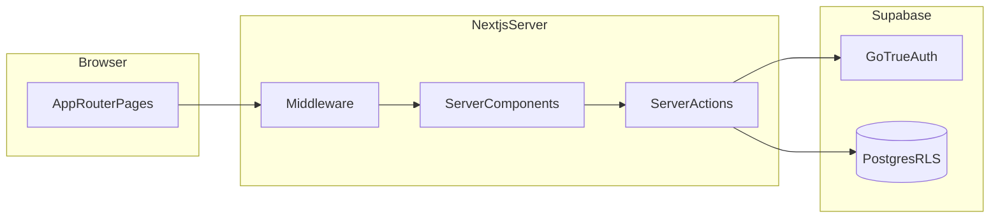

# Phase 1 core PRM implementation

This ExecPlan is a living document. The sections `Progress`, `Surprises & Discoveries`, `Decision Log`, and `Outcomes & Retrospective` must be kept up to date as work proceeds.

Repository ExecPlan authoring rules live at `.agent/PLANS.md`. This document must be maintained in accordance with that file.

**Prerequisite (checked in):** Platform scaffolding, Phase 1 migration, RLS policies, and Supabase server helpers are described in `docs/plans/initialize-project.md`. This plan assumes that work is complete: tables `people`, `contact_methods`, `interactions`, `interaction_people` exist under `supabase/migrations/20260404190722_phase_1_initial_schema.sql`, and `src/lib/db/server.ts` provides cookie-aware `createSupabaseServerClient`.

---

## Purpose / Big Picture

After this work, a user can manage relationship data in a private workspace: create and edit **people** (with category and status), attach **contact methods** (with a single primary per person), log **interactions** (including **multi-person** events stored once and linked via `interaction_people`), and browse a **per-person timeline** and a **global timeline** across the PRM. With normal auth enabled, another user cannot see their data because Postgres **row-level security** enforces ownership.

For **local testing**, the owner may enable an optional **development-only bypass** so the PRM pages work **without signing in**, using server-side access to local data for speed and simplicity. That mode must remain impossible in production builds.

Validation paths:

- **Full Phase 1:** Run local Supabase and Next.js, sign up and sign in with **email and password**, walk through the Phase 1 scenarios in `docs/personal-prm-user-stories.md`, and confirm timelines and isolation in the UI.

- **Simplified local:** With bypass enabled per the Decision Log, open People and Timeline and exercise CRUD **without** a session, confirming data still lands under a fixed dev `user_id` in Postgres.

---

## Progress

- [x] (2026-04-04) Add optional **local dev auth bypass** (server-only, env-gated) and document required env vars in `.env.example`.
- [x] (2026-04-04) Add auth routes, session refresh middleware, and a protected app shell with navigation (bypass skips protection only when the bypass flag is on).
- [x] (2026-04-04) Implement people list (with optional category/status filters and name search), create, and edit.
- [x] (2026-04-04) Implement contact methods on the person detail page with primary exclusivity.
- [x] (2026-04-04) Implement interaction create from a person (pre-linked) and global interaction entry with multi-person linking.
- [x] (2026-04-04) Maintain `people.last_interaction_at` in application code when interactions are created or deleted (and when `occurred_at` changes if edit is supported).
- [x] (2026-04-04) Implement global timeline page and person detail timeline (chronological, links to people).
- [x] (2026-04-04) Run `npm run lint` and `npm run build`; document manual acceptance steps in this plan’s Validation section.

Use timestamps on items as they complete, per `.agent/PLANS.md`.

---

## Surprises & Discoveries

- `error.message as const` is invalid TypeScript; use a plain string for dynamic Supabase errors in action helpers.
- Next.js 16 build lists middleware as `ƒ Proxy (Middleware)`; session refresh runs on the matcher while PRM route protection stays in the `(prm)` layout via `requirePrmAccess()` so bypass env vars remain server-only (not required on the Edge middleware runtime).

---

## Decision Log

- **Decision:** Phase 1 authentication is **email + password** via Supabase Auth.  
  **Rationale:** Explicit product choice for predictable local testing and straightforward UX.  
  **Date:** 2026-04-04 / User

- **Decision:** Phase 1 validation targets **local Supabase only**; hosted Supabase URL allowlists and production redirects are out of scope for this plan.  
  **Rationale:** Reduces moving parts while the PRM loop is proven end to end.  
  **Date:** 2026-04-04 / User

- **Decision:** For **local development only**, support working **without signing in** so testing stays simple.  
  **Rationale:** The owner wants to iterate on UI and data flows without repeating login during early implementation.  
  **Date:** 2026-04-04 / User

- **Decision:** Implement that convenience as an explicit **opt-in dev bypass**, never as default behavior in production.  
  **Rationale:** The service role key and skipping `auth.uid()` in the browser session are dangerous if misconfigured; gating bypass behind `NODE_ENV === 'development'` plus a named env flag (for example `PRM_LOCAL_DEV_BYPASS_AUTH=true`) keeps the happy path honest while preserving speed locally.  
  **Date:** 2026-04-04 / User

- **Decision:** In bypass mode, use a **server-only Supabase client with the service role key** and scope every read/write to a single configured UUID, `PRM_LOCAL_DEV_USER_ID`, that must exist in `auth.users` (because `people.user_id` and `interactions.user_id` reference it). Document one-time creation of that user (Supabase Studio, `supabase auth`, or a single manual sign-up followed by copying the UUID into `.env.local`).  
  **Rationale:** RLS continues to apply to the anon and user clients; bypass does not weaken production. Using a real `auth.users` row keeps foreign keys valid without loosening the schema.  
  **Date:** 2026-04-04 / Assistant

- **Decision:** Maintain `last_interaction_at` in **application code** after writes to `interactions` / `interaction_people`, not a new DB trigger in Phase 1.  
  **Rationale:** Matches the open decision in `docs/phase-1-mvp-schema-design.md`; keeps logic visible in one place and avoids a second migration unless triggers are later preferred.

- **Decision:** Do not add `interaction_people` **update** RLS policies unless the UI needs to change a person’s role on an existing interaction; Phase 1 can model corrections as **delete row + insert row** or by deleting and recreating the interaction.  
  **Rationale:** Current migration grants select/insert/delete only on `interaction_people`; extending policies is optional scope.

---

## Outcomes & Retrospective

Complete when Phase 1 user stories are demonstrably satisfied locally (with or without bypass, as documented). Summarize gaps (for example deferred polish), and lessons about Supabase + App Router patterns, here at milestone end.

---

## Context and Orientation

**Next.js App Router** routes live under `src/app`. Default to **Server Components**; add `'use client'` only for forms that need controlled inputs, client-only validation UX, or multi-select state that is awkward on the server.

**Supabase SSR** here means the server constructs a Supabase client that reads and writes the user’s **session cookies** so RLS sees `auth.uid()`. The existing helper is `src/lib/db/server.ts`. **Browser client** from `src/lib/db/browser.ts` is for client components if needed (for example auth listener); prefer server actions for mutations to keep secrets off the client.

**Local dev without sign-in:** When bypass is enabled, product routes do not redirect to login. Server actions and Server Component loaders use a **service role** client (new helper under `src/lib/db/`, marked `server-only`) only on the server, never imported from client components. That client bypasses RLS, so application code must **manually filter** by `PRM_LOCAL_DEV_USER_ID` on `people` and `interactions`, and must set `user_id` to that same value on inserts. **Never** enable bypass outside development; **never** expose the service role key to the browser.

**Row-level security (RLS)** means the database rejects cross-tenant access for normal authenticated traffic. Server actions must still **set `user_id` from the session** (or from `PRM_LOCAL_DEV_USER_ID` in bypass mode only), never from unvalidated client input, on insert.

**Multi-person interactions:** one row in `interactions`, many rows in `interaction_people`. The “primary” vs “attendee” **role** distinguishes the main subject from others for display; when logging from a person’s page, that person should default to `primary` and additional people to `attendee`.

**Primary contact method:** a **partial unique index** already enforces at most one `is_primary` per person. When marking a new primary, the app must **clear other primaries** for that person in the same logical operation (transaction or two ordered updates) to avoid unique-index violations.

**Local auth config:** `supabase/config.toml` sets `site_url = "http://127.0.0.1:3000"` and `auth.email.enable_confirmations = false`, which suits frictionless local signup. If developers use `http://localhost:3000`, add it to `additional_redirect_urls` (and align `site_url` if needed) so redirects are not rejected.

---

## Plan of Work

### Milestone A — Authentication, optional local bypass, and shell

**Local bypass first (or alongside auth):** Add `createSupabaseServiceRoleClient()` (or equivalent) in `src/lib/db/` using `SUPABASE_SERVICE_ROLE_KEY` from `src/lib/env.ts`, loading only when `NODE_ENV === 'development'` and `PRM_LOCAL_DEV_BYPASS_AUTH` is truthy. Centralize “which Supabase client and effective `user_id`?” in one small module used by data loaders and server actions so bypass and real sessions do not diverge.

Add **sign up**, **sign in**, and **sign out** using Supabase `signUp`, `signInWithPassword`, and `signOut`. Use route segments such as `src/app/(auth)/login/page.tsx` and `src/app/(auth)/signup/page.tsx` (names flexible; keep URLs stable once chosen). Forms may be client components posting to **server actions** that call `createSupabaseServerClient()` and return structured errors (avoid leaking raw stack traces to the UI).

Add **middleware** following Supabase’s Next.js SSR guidance: refresh the session on each request so cookies stay valid. When bypass is **off**, protect product routes. When bypass is **on**, skip auth redirects for those routes but still run session refresh if you want cookies to remain valid when switching modes.

**Decision:** After sign-in (non-bypass), send users to **`/people`**. The home page at `src/app/page.tsx` redirects anyone with a session (or active local bypass) to **`/people`** and otherwise stays a **signed-out landing** with Sign in / Create account plus setup guidance.

### Milestone B — People

Implement `src/app/people/page.tsx`: list the effective user’s people (server-side query ordered by `full_name` or `last_interaction_at` per product preference). Support **filtering** by `category` and `status` and **search** by `full_name` (case-insensitive `ilike` or client filter for small lists; prefer DB-side `ilike` as data grows). Add `src/app/people/new/page.tsx` (or a modal pattern) for create with required `full_name`, `category`, and optional fields from the schema doc.

Implement `src/app/people/[id]/page.tsx`: load one person by `id` and effective `user_id` match; show profile fields and **edit** affordance (inline form or `/people/[id]/edit`). Copy and labels should stay **warm and non-corporate** per `AGENTS.md`.

### Milestone C — Contact methods

On the person detail route, list `contact_methods` for that person. Support add, edit, delete, and **set primary** (unset siblings then set one `is_primary = true`). Enforce ownership by scoping through the person row the effective user owns (RLS for session mode; explicit `user_id` / person ownership checks in bypass mode).

### Milestone D — Interactions and `last_interaction_at`

Add interaction creation from the person page: fields `occurred_at`, `type`, optional `title`, `raw_note`. Insert `interactions` with the effective `user_id`, then insert `interaction_people` with the current person as `primary` and optional additional people.

Add a path to log a **multi-person** interaction (for example `/interactions/new` or a flow from the global timeline) where the user picks **one primary** and **N attendees**, creates one `interactions` row, and inserts one `interaction_people` row per selected person.

**After each insert or delete** (and after `occurred_at` update if edits are implemented), recompute `last_interaction_at` for every affected person: query the maximum `interactions.occurred_at` for interactions linked to that person via `interaction_people`, or set null if none remain. Implement this in a small helper under `src/lib/` (for example `src/lib/interactions/last-touch.ts`) called from server actions to avoid duplication.

**Optional scope control:** Phase 1 can allow **delete** of interactions; **edit** of `occurred_at` or note is recommended for honesty but can be deferred—if omitted, state that explicitly in Progress.

### Milestone E — Timelines

**Person timeline:** on `people/[id]`, query interactions joined through `interaction_people` ordered by `occurred_at` descending; show type, date, note snippet, and link to edit/delete if implemented.

**Global timeline:** `src/app/timeline/page.tsx` lists `interactions` for the effective `user_id` ordered by `occurred_at` descending; each row lists linked people (from `interaction_people` join) with links to their profiles.

### Milestone F — Types, polish, and validation

Generate TypeScript types from the local schema (`npx supabase gen types typescript --local`) into something like `src/lib/db/database.types.ts` and use them in query helpers to reduce drift.

Ensure navigation between People, Timeline, and auth is obvious. Run `npm run lint` and `npm run build`. Perform manual acceptance against the Phase 1 scenarios in `docs/personal-prm-user-stories.md`.

---

## Concrete Steps

From the repository root (see `docs/plans/initialize-project.md` for baseline):

1. Start Docker, then `npx supabase start` and `npx supabase db reset` so the database matches migrations.
2. Copy env vars per `.env.example`; run `npm install`, `npm run dev`.
3. Create a **dev auth user** once if using bypass: sign up through the app or Supabase tooling, then set `PRM_LOCAL_DEV_USER_ID` to that user’s UUID and `PRM_LOCAL_DEV_BYPASS_AUTH=true` in `.env.local` together with `SUPABASE_SERVICE_ROLE_KEY` from `npx supabase status`.
4. Implement milestones A through F in order, committing after each verified milestone.
5. Optionally run `npx supabase gen types typescript --local > src/lib/db/database.types.ts` (exact path per team convention) after schema is stable.

If auth redirects fail, verify `site_url` and `additional_redirect_urls` in `supabase/config.toml` match the URL bar the browser uses (`127.0.0.1` vs `localhost`).

---

## Validation and Acceptance

Observable checks (Phase 1 only):

1. **Local bypass (optional):** With bypass enabled, open `/people` and `/timeline` without signing in; create a person and an interaction; confirm rows in Supabase Table Editor use `PRM_LOCAL_DEV_USER_ID`. Turn bypass off and confirm routes require login again.
2. **Auth:** Register a new user with email/password; sign in; refresh the page; session persists. Sign out; protected routes redirect or show login.
3. **Isolation:** Create a second user (different email); confirm they see an empty people list and cannot access the first user’s person IDs (RLS should return empty or error; UI should handle gracefully).
4. **People:** Create a person with category and status; they appear on the list; filters and search behave as implemented.
5. **Contact methods:** Add two methods; mark one primary; attempt a second primary and confirm the app resolves to a single primary (no unique index error).
6. **Interaction:** Log an interaction from a person; it appears on that person’s timeline; `last_interaction_at` updates.
7. **Multi-person:** Log one interaction with two people; both person pages show the same interaction; interaction appears once on the global timeline.
8. **Quality:** `npm run lint` and `npm run build` succeed.

**Automated check (2026-04-04):** `npm run lint` and `npm run build` completed successfully in the implementation environment. Manual walks through the numbered scenarios above remain the source of truth for auth, bypass, and RLS isolation.

---

## Idempotence and Recovery

Migrations are already additive; Phase 1 product work should not require schema rewrites. If a server action partially fails (interaction inserted but links not), catch and delete the orphan or use a **database transaction** via Supabase RPC or a single Postgres function—if that is too heavy for v1, document the rare orphan risk and handle with manual DB cleanup during dev.

Reset local data anytime with `npx supabase db reset`. After reset, recreate the dev `auth.users` row (sign up again) and update `PRM_LOCAL_DEV_USER_ID` if the UUID changed.

---

## Artifacts and Notes

Keep short command transcripts (lint/build, db reset) in **Surprises & Discoveries** or here as you validate.

---

## Interfaces and Dependencies

**Dependencies:** Existing `next`, `@supabase/supabase-js`, `@supabase/ssr`, Tailwind. No new auth provider packages required for email/password.

**Server actions (illustrative):** `createPerson`, `updatePerson`, `upsertContactMethod`, `setPrimaryContactMethod`, `createInteractionWithPeople`, `deleteInteraction`, `refreshLastInteractionAtForPersonIds(personIds: string[])`.

**Env (illustrative, document in `.env.example`):** `PRM_LOCAL_DEV_BYPASS_AUTH`, `PRM_LOCAL_DEV_USER_ID`, `SUPABASE_SERVICE_ROLE_KEY` (local only).

**Middleware:** Session refresh; optional auth guard unless bypass is on; keep matcher tight to avoid static asset churn.

---

**Revision note (initial):** Auth method and deployment scope confirmed earlier; local **no-sign-in** dev mode added per owner request, with service-role + fixed `user_id` guardrails.
